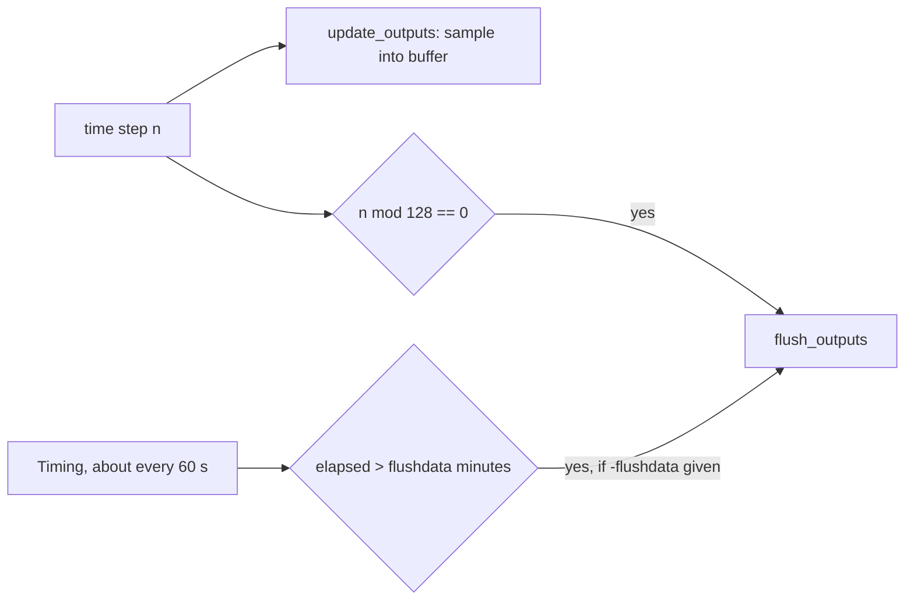
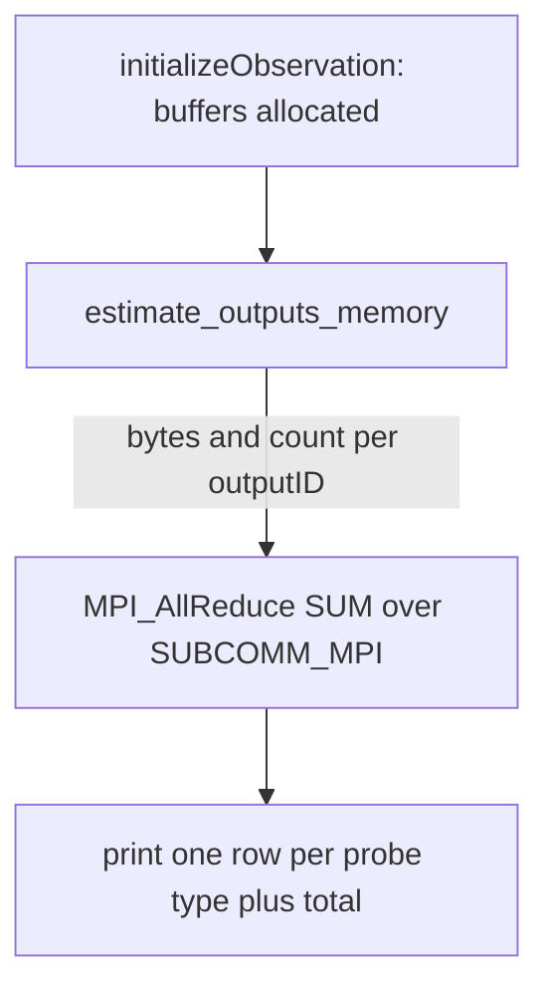

# Init Timing Report

The `Init Timing...` block is printed once, after the probes are initialised
and right before the time-stepping loop starts
(`src_main_pub/timestepping.F90`, `InitTiming` in `src_main_pub/progress.F90`).
It summarises what the solver is about to do: probe buffer memory, mesh size,
flush policy and reporting cadence.

## Before and after

Before:

```
Init Timing...
Total Mcells:   0.125000000
NO flushing of restarting FIELDS scheduled
Flushing observation DATA every      10000001  minutes and every         1024  steps
Reporting simulation info every             1  minutes
```

After:

```
Init Timing...
Probe buffer memory (estimate, all ranks):
movie                  1 probes          0.41 MB
total                  1 probes          0.41 MB
Total Mcells:   0.125000000
Restart FIELDS flush: none scheduled
Observation DATA flush: every 128 steps; time-based: none
Reporting simulation info every 1 minutes
```

## What was wrong

| Old line | What it claimed | What actually happens |
|---|---|---|
| `every 10000001 minutes` | A time-based flush every ~19 years | `TOPCPUTIME` is the "no time-based flush" sentinel; the extra `1` came from a single-precision `seconds/60.0` division. |
| `every 1024 steps` | Buffer flush every `BUFFOBSE` steps | `BUFFOBSE` is legacy. Probes flush every `OUTPUT_TIME_BUFFER_SIZE` (128) steps. |
| `NO flushing of observation DATA scheduled` | No probe data is written | The step-based flush always runs; the warning was removed. |

## Lines

| Line | Source | Values |
|---|---|---|
| `Probe buffer memory` | `report_outputs_memory` (`src_output/output.F90`) | Only printed when there are probes. One row per probe type in use, then the total. |
| `Total Mcells` | Sweep extent, summed over MPI ranks | Millions of cells. |
| `Restart FIELDS flush` | `-flush <minutes>`, `maxCPUtime` | `every N minutes`, `at the end, after N minutes`, or `none scheduled`. |
| `Observation DATA flush` | `OUTPUT_TIME_BUFFER_SIZE`, `-flushdata <minutes>` | `every 128 steps; time-based: none` or `... time-based: every N minutes`; `no probes` when there is nothing to observe. |
| `Reporting simulation info` | `REPORTINGSECONDS` | Minutes between progress reports. |

## How probe data reaches disk



## Memory estimate



`estimate_outputs_memory` adds `size * storage_size` of every allocated buffer
held by each probe: time samples, frequency accumulators, coordinates and
material tags. Time buffers have a fixed size of `ceil(128 / tstride)` samples
(`time_buffer_capacity`), so the figure is valid for the whole run.

Each row is the sum over all probes of that type. Two rows come from outside
the `outputs` array:

- `far field`: the near-to-far-field DFT accumulators held in `FF`
  (`farfield_buffer_bytes` in `src_main_pub/farfield.F90`). All far-field probes
  share this single accumulator, so the row reports it once.
- `MTLN`: wire probes solved by MTLN (`src_mtln/probes.F90`), reached through
  `GetSolverPtr`. They buffer a single frame, so they are usually 0.00 MB.

Limits:

- HDF5, MPI transport and metadata buffers are not included.
- Under MPI, a probe split across ranks is counted once per rank.
