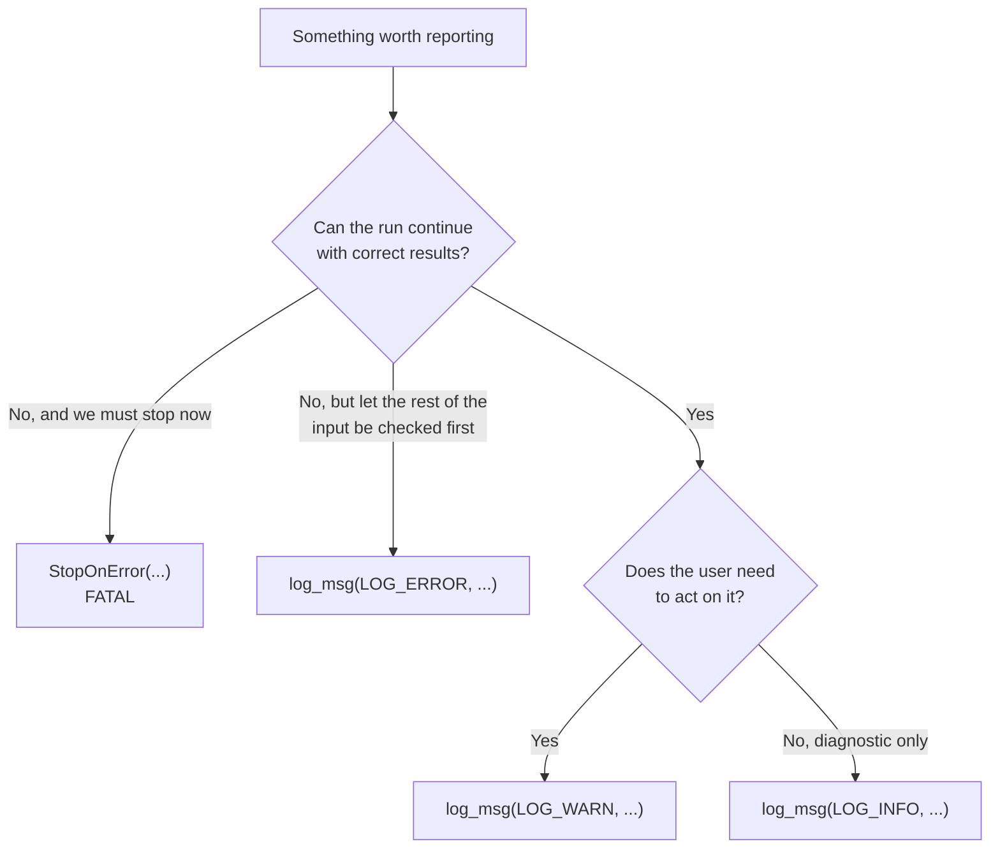
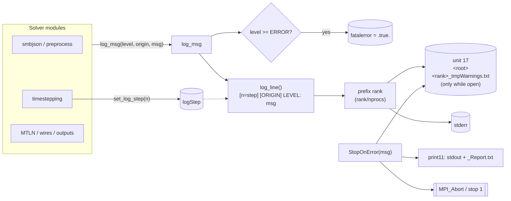
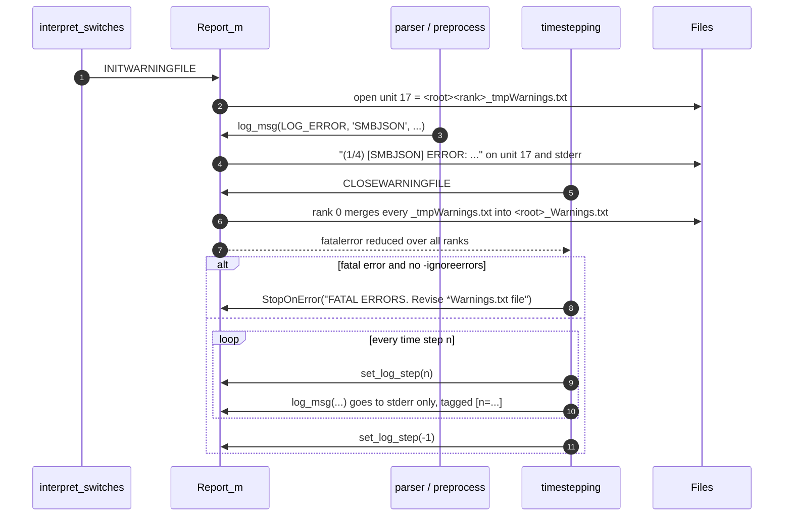

# Solver logging

This page describes how semba-fdtd reports warnings, errors and diagnostic
messages, and how to add new ones. The implementation lives in
`Report_m` (`src_main_pub/errorreport.F90`).

## Summary

- Every diagnostic message goes through one call:
  `call log_msg(LEVEL, 'ORIGIN', message)`.
- Each line carries the MPI rank, the time step (inside the time loop), the
  subsystem that emitted it and its severity:

  ```text
  (    2/    4) [n=1200] [WIRES] WARN: wir0_WARNING: ...
  └── rank ───┘ └ step ┘ └origin┘ └level┘ └─ message
  ```

- `LOG_ERROR` marks the run as failed. Before the time loop starts, the solver
  aborts unless `-ignoreerrors` was given. `LOG_INFO` and `LOG_WARN` never stop
  the run.
- `StopOnError` is still the immediate-abort path. Its message is now tagged
  `FATAL` and also written to the warnings file.
- `print11` is unchanged. It writes formatted, human-oriented output (banners,
  tables, progress) to stdout and `_Report.txt`. It is not a diagnostics
  channel.

## Levels

| Level | Constant | Use it for | Sets fatal flag | Typical source |
|---|---|---|---|---|
| `INFO` | `LOG_INFO` | Diagnostics, configuration dumps, verbose traces | no | `-verbose` output, media dump, wire topology |
| `WARN` | `LOG_WARN` | Something odd that the solver can work around | no | ignored sources, write failures that are skipped |
| `ERROR` | `LOG_ERROR` | Invalid input or state; the run must not proceed | **yes** | parser validation, unsupported geometry |
| `FATAL` | (internal) | Emitted only by `StopOnError`; the process exits right away | n/a | unrecoverable conditions |



## Message flow



## Warnings file lifecycle

Each rank writes its own temporary file. Rank 0 merges them into
`<root>_Warnings.txt` and reduces the fatal flag across ranks with
`MPI_AllReduce(MPI_LOR)`.



The warnings file is closed before the time loop starts. Messages emitted
during time stepping therefore go to **stderr only**. That is where the
`[n=...]` tag is most useful.

## Output files

| File | Writer | Content |
|---|---|---|
| `<root><rank>_tmpWarnings.txt` | `log_msg`, `StopOnError` on every rank | Per-rank messages before the time loop. They are left on disk if the run aborts. |
| `<root>_Warnings.txt` | `CLOSEWARNINGFILE` on rank 0 | Merged messages from every rank |
| `<root>_Report.txt` | `print11` on rank 0 | Human-oriented run report: banners, configuration, progress |
| stderr | `log_msg` on every rank | Every leveled message, including those emitted inside the time loop |
| stdout | `print11` | Same content as `_Report.txt` while printing is on (`OnPrint` / `OffPrint`) |

## Origins

The origin tag names the subsystem, not the file. Reuse an existing tag where
one fits:

| Origin | Area |
|---|---|
| `SMBJSON` | `.fdtd.json` parser |
| `PREPROCESS` | geometry preprocessing (`preprocess_geom.F90`) |
| `ROTATE` | NFDE rotation for MPI layouts |
| `WIRES` | Holland / thin-wire models |
| `MTLN` | multiconductor transmission lines and ngspice |
| `SOLVER` | time-stepping setup and loop |
| `MEDIA` | media dump (`-verbose`) |
| `SOURCES`, `PLANEWAVE`, `LUMPED` | excitations and lumped elements |
| `SGBC`, `EDISPERSIVE`, `MDISPERSIVE` | material models |
| `PML`, `CPML`, `MUR` | boundaries |
| `FARFIELD`, `OUTPUT`, `PROGRESS`, `RESUMING` | outputs, progress and restart |
| `MAIN` | `semba_fdtd.F90` launch flow |
| `MPI` | MPI communication setup (`mpicomm.F90`) |

## Writing a new message

```fortran
use Report_m, only: log_msg, LOG_INFO, LOG_WARN, LOG_ERROR

write(buff, *) 'Thin slot width ', width, ' is below the cell size'
call log_msg(LOG_WARN, 'PREPROCESS', buff)

call log_msg(LOG_ERROR, 'SMBJSON', 'Unknown probe type "'//trim(probeType)//'"')

! Runtime choice of severity
call log_msg(merge(LOG_ERROR, LOG_WARN, isFatal), 'WIRES', buff)
```

Guidelines:

- Do not put `WARNING:` or `ERROR:` in the message text: the level is already
  printed. Older messages still carry tags such as `wir0_WARNING:`; remove
  them when you edit those lines.
- Use `LOG_ERROR` only when the run has to stop. It sets the fatal flag.
- Do not use `print *` or `write(*,*)` for diagnostics. Those messages bypass
  the warnings file and carry no rank or step.
- Inside the time loop, `log_msg` adds the step automatically. Do not format
  `n` into the message.

## Before and after

| Before | After |
|---|---|
| `call WarnErrReport(buff)` | `call log_msg(LOG_WARN, 'ORIGIN', buff)` |
| `call WarnErrReport(buff, .true.)` | `call log_msg(LOG_ERROR, 'ORIGIN', buff)` |
| `call WarnErrReport(buff, flag)` | `call log_msg(merge(LOG_ERROR, LOG_WARN, flag), 'ORIGIN', buff)` |
| `print *, 'Bug in tags'` then `stop` | `call log_msg(LOG_ERROR, 'PREPROCESS', 'Bug in tags')` then `stop` |
| `print *, msg` then `stop` (must exit now) | `call StopOnError(layoutnumber, num_procs, msg)` |
| `(    1/    1) some text` | `(    1/    1) [n=42] [WIRES] WARN: some text` |
| `(    1/    1) ERROR: msg` (StopOnError, console only) | `(    1/    1) FATAL: msg` (console and warnings file) |

## Known limitations

- **No step tag in `_Warnings.txt`.** The warnings file is merged and closed
  before the time loop, so `[n=...]` only shows up on stderr.
- **`StopOnError` has no origin.** Its call sites still pass only a message.
- **`stop` exits with code 0.** Some preprocessing paths log `LOG_ERROR` and
  then call a bare `stop`, which still exits 0. `StopOnError` exits 1.
- **Levels were assigned mechanically.** During the migration, the level came
  from the old error flag: messages whose text says `INFO`, or that only print
  under `verbose`, became `INFO`, and the rest became `WARN`. Some `WARN`
  messages are really informational. Reclassify them when you touch them.
- **No level filter.** There is no `-loglevel` switch yet. Use `-verbose` to
  get the extra `INFO` output that already depends on it.
